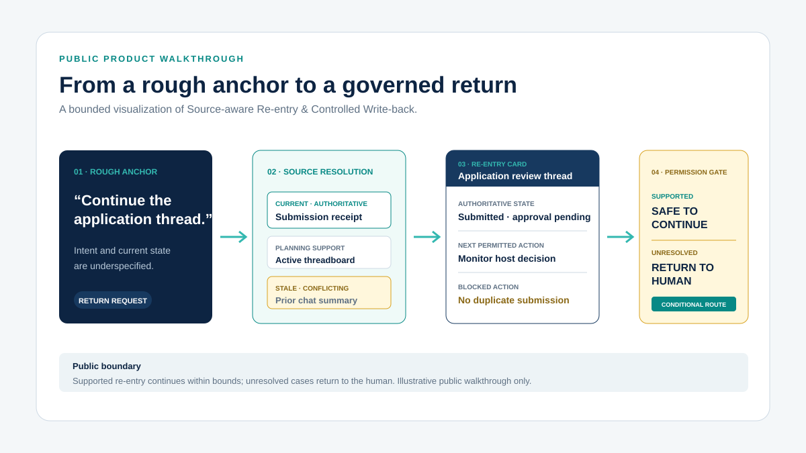

# ZL Subbrain OS

**A control-centered, continuity-sensitive human-AI collaboration operating system.**

ZL Subbrain OS is the Whole-System and product identity.

[Zyline Tech Inc.](https://zl-subbrain-os.liaofanhot.chatgpt.site/company) is the company advancing its engineering-validation and commercialization pathway.

[Website](https://zl-subbrain-os.liaofanhot.chatgpt.site) · [System](https://zl-subbrain-os.liaofanhot.chatgpt.site/system) · [Engineering Validation](https://zl-subbrain-os.liaofanhot.chatgpt.site/validation)

## See It Work

**[Open the 60-second interactive walkthrough →](https://zl-subbrain-os.liaofanhot.chatgpt.site/demo)**

The walkthrough makes the first validated slice visible: a rough return anchor is resolved against current and stale sources, reconstructed as a bounded Re-entry Card, and passed through a deterministic permission gate.

Human involvement is conditional rather than the default mechanism: a supported re-entry may continue within bounded authority; unresolved conflicts, missing authority, insufficient evidence, or pending human decisions return control to the human.

The example is intentionally public and illustrative. It is not a live production deployment, a connection to private runtime data, or a claim of Whole-System completion.

## Why This Exists

Long-horizon human-AI work carries continuing interpretation, judgment, thread recognition, priority, coordination, recovery, execution return, and closure across changing models, windows, providers, tools, people, and formal sources.

Stronger models and longer context windows do not automatically determine:

- which facts and rules are currently valid
- which thread is active
- where the work stands
- what action is permitted
- how returned work reconnects to the correct control position

ZL Subbrain OS is designed to preserve judgment, control, shared state, and continuity governance across that change.

**Information recovery is not the same as governing continuity.**

## Whole-System Responsibilities

The public system view describes six responsibility areas operating as one governed structure:

1. **Central Control** — maintains the main line, priority, routing, recovery, return, and closure.
2. **Definition Source & Runtime Truth** — determines system identity, applicable boundaries, and the current authoritative operating basis.
3. **Continuity Support** — preserves the identity, thread, anchors, and minimum authoritative basis that must survive change.
4. **Shared State & Global State Awareness** — keeps active threads, priorities, roles, coordination, and current work position coherent.
5. **Protocol, Execution & Return** — translates bounded decisions into handoff, tool execution, delivery, return, attach, and re-entry.
6. **Human × Central Control Governance** — preserves human direction, gates, correction, override, stopping, canonical promotion, and final acceptance.

This is a governed operating topology, not a linear task flow.

## System, Company, and Named Identity

- **ZL Subbrain OS** — Whole-System and product identity
- **Zyline Tech Inc.** — company advancing the engineering-validation and commercialization pathway
- **Leo** — the named subbrain identity operating within ZL Subbrain OS

Models, windows, tools, and runtime environments may change. The named identity and its control relationship are supported by language protocols and structured truth.
